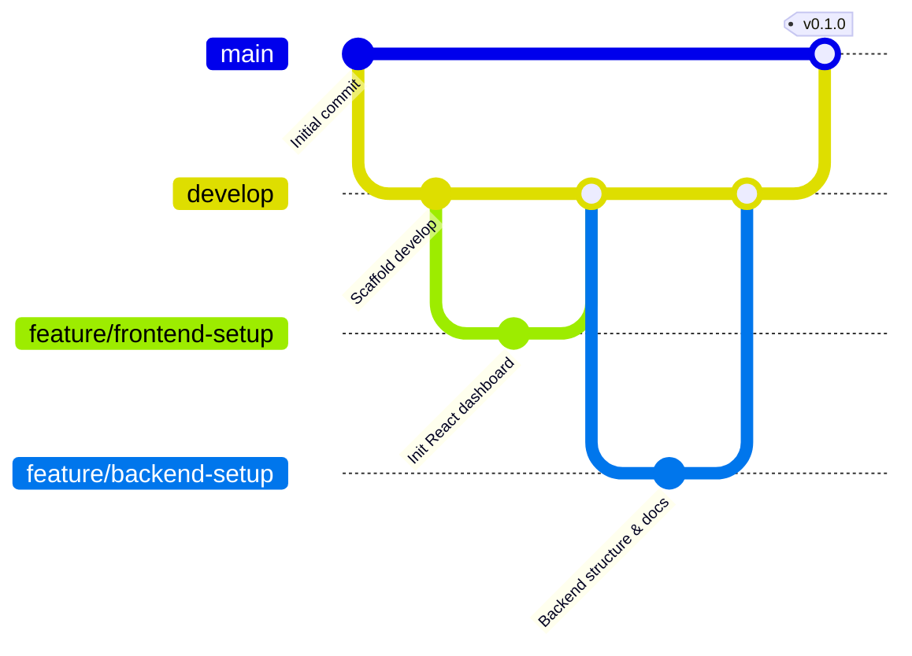

# DevTogether — Project Documentation

**Project Name:** DevTogether  
**Version:** 0.1.0 (Scaffolding & Architecture Planning)  
**Status:** In Initial Setup  
**Repository:** [https://github.com/KaifKazmi0/DevTogether.git](https://github.com/KaifKazmi0/DevTogether.git)

---

## 1. Project Overview

**DevTogether** is a shared contribution-tracking and collaboration dashboard engineered specifically for two co-developers (and small collaborative teams). It provides a unified view of development velocity by merging two primary streams of activity:

1. **Manual Daily Work Logs:** Structured entries written by collaborators documenting tasks completed, time invested, work categories, and evidence links (especially for non-code contributions such as architecture design, manual QA, bug triaging, code reviews, and documentation).
2. **Imported GitHub Activity:** Verified commits, pull requests, reviews, and issue events synchronized from the project's GitHub repository.

Unlike conventional platforms that measure developer output solely through git commit volume or lines of code, DevTogether emphasizes **consistency, transparency, and balanced teamwork**. It recognizes that critical software engineering milestones occur both inside and outside of git commits.

---

## 2. Problem Statement & Objectives

### 2.1 Problem Statement
In collaborative software projects, tracking real progress is often difficult:
- **Blind spots in git metrics:** GitHub contribution graphs only record git commits, pull requests, and issues. Essential work such as architecture design, pair programming, debugging, research, manual testing, and writing documentation goes unrecorded.
- **Overhead of enterprise tools:** Heavy project management platforms (Jira, Linear, Asana) introduce unnecessary friction, configuration overhead, and ceremony for two collaborators working closely together.
- **Lack of mutual visibility:** Without a lightweight, dedicated dashboard, team members often lack real-time visibility into what the other person worked on each day, current active streaks, or weekly milestones.

### 2.2 Project Objectives
- **Shared Collaboration View:** Provide both developers with a synchronized dashboard that highlights individual contributions while visualizing team progress.
- **Comprehensive Activity Recording:** Allow developers to log daily work details (summary, category, time spent, status, reference URLs) in seconds.
- **Individual Contribution Heatmaps:** Render GitHub-style calendar heatmaps for each developer, reflecting both manual logs and imported GitHub activity.
- **Fair Streak & Momentum Calculation:** Calculate current and longest streaks based on active calendar days evaluated in each user's configured timezone.
- **Weekly Progress & Comparison:** Compare active days, completed tasks, and total logged hours side-by-side using identical criteria.
- **Lightweight Task Management:** Manage project tasks with assignees, status transitions, and optional links to GitHub issues or pull requests.
- **Reliable GitHub Sync:** Periodically import repository activity without duplicating events across recurring sync runs.
- **Low-Cost / Zero-Cost Deployment:** Support local development via Docker Compose and enable straightforward deployment on modern free-tier hosting platforms.

---

## 3. Main Features

### 3.1 Individual Calendar Heatmaps
- Visual GitHub-style calendar heatmap for each collaborator.
- Daily cell intensity based on recorded activity (manual logs and/or GitHub events).
- Interactive day selection to view detailed records (logs and commits/PRs) for that calendar date.
- Explicit scoring formula that keeps manual logs and GitHub events distinct rather than naively summing incompatible units of work.

### 3.2 Daily Work Logs
- Manual log submission with fields:
  - **Date:** The calendar date the work occurred.
  - **Summary:** Concise description of the work performed.
  - **Category:** Tagging work as Development, Bug Fix, Code Review, Testing, Documentation, Design, or Planning.
  - **Hours Spent:** Time allocated (in hours/fractions of hours).
  - **Status:** Completion status (`Completed`, `In Progress`, `Blocked`).
  - **Evidence URL:** Optional external URL (e.g., Figma link, documentation page, PR link).
- Ownership protection: Users can create, view, edit, and delete their own logs; collaborators can view but not modify each other's logs.

### 3.3 Weekly Statistics & Comparisons
- Side-by-side metric comparison across matching date windows (e.g., Monday through Sunday).
- Metrics tracked:
  - Total active days in the week.
  - Total logged hours.
  - Tasks completed during the week.
- Designed to motivate consistency rather than foster unhealthy competition.

### 3.4 Tasks Management
- Lightweight task tracking associated with the project.
- Key properties: title, description, assignee, status (`Todo`, `In Progress`, `Done`), start date, due date, and optional GitHub issue/PR URL.
- Task completion criteria: A task is only counted as complete when marked `Done`. Commits alone do not automatically close tasks.

### 3.5 Authentication & User Management
- Secure authentication mechanism allowing both collaborators access to the dashboard.
- User management storing display name, internal user ID, associated GitHub username, and preferred timezone.
- Timezone awareness: Crucial for accurate date boundary evaluation and streak calculations near midnight.

### 3.6 Contributions & Streak Logic
- **Active Day Definition:** A calendar day with at least one qualifying GitHub activity event or an approved manual work log.
- **Streak Calculation:** Consecutive active calendar days computed using the user's configured timezone. A missed day resets the current streak.
- Preserves the historical longest streak.

### 3.7 GitHub Integration
- Automated and on-demand synchronization with the connected GitHub repository using the GitHub REST API.
- Imports commits, pull requests, code reviews, and issue activities.
- Deduplication: Events indexed by unique provider/repository/external ID to prevent duplicate counts during repeated sync runs.
- Sync history tracking with run status, start/end timestamps, and error summaries.

---

## 4. Technology Stack

### 4.1 Frontend
- **Framework:** React 18+
- **Language:** TypeScript / JavaScript (JSX)
- **Build Tool & Dev Server:** Vite
- **Routing:** React Router (`react-router-dom`)
- **Icons & Styling:** Lucide React (`lucide-react`), Modern CSS / CSS Modules
- **Charts / Visualizations:** Recharts or custom SVG heatmap components

### 4.2 Backend
- **Platform:** Java (JDK 17+)
- **Framework:** Spring Boot (Spring Web / WebMVC)
- **Security:** Spring Security (Token / Session based authentication — `TBD`)
- **Persistence:** Spring Data JPA / Hibernate (planned)
- **API Documentation:** Springdoc OpenAPI / Swagger (`TBD`)
- **Build Tool:** Maven (`pom.xml`)

### 4.3 Database & Infrastructure
- **Database:** PostgreSQL (relational storage for users, daily logs, GitHub events, tasks, sync runs)
- **Local Infrastructure:** Docker Compose (orchestrating PostgreSQL and local services)
- **Production Hosting:** Free-tier static hosting (Frontend) and container/app hosting (Backend & Database) — `TBD`

---

## 5. High-Level Architecture

The following diagram illustrates the interaction between the system layers:

```mermaid
flowchart TD
    subgraph Client["Frontend Layer (React + Vite)"]
        UI["Dashboard UI\n(Heatmap, Logs, Tasks, Stats)"]
        APIClient["API Client Services\n(REST calls via fetch / axios)"]
        UI --> APIClient
    end

    subgraph Backend["Backend Layer (Spring Boot)"]
        AuthModule["auth/\n(Authentication & Security)"]
        UsersModule["users/\n(User & Profile Management)"]
        LogsModule["logs/\n(Daily Work Logs CRUD)"]
        ContribModule["contributions/\n(Heatmap, Streaks, Weekly Stats)"]
        TasksModule["tasks/\n(Project Tasks Management)"]
        GithubModule["github/\n(Sync Service & Event Deduplication)"]
    end

    subgraph DataStore["Persistence Layer"]
        Postgres[("PostgreSQL Database\n(Users, Logs, Events, Tasks, SyncRuns)")]
    end

    subgraph External["External Services"]
        GitHubAPI["GitHub REST API\n(Commits, PRs, Issues, Reviews)"]
    end

    APIClient -->|HTTP / JSON| AuthModule
    APIClient -->|HTTP / JSON| UsersModule
    APIClient -->|HTTP / JSON| LogsModule
    APIClient -->|HTTP / JSON| ContribModule
    APIClient -->|HTTP / JSON| TasksModule
    APIClient -->|HTTP / JSON| GithubModule

    AuthModule --> Postgres
    UsersModule --> Postgres
    LogsModule --> Postgres
    ContribModule --> Postgres
    TasksModule --> Postgres
    GithubModule --> Postgres

    GithubModule -->|REST API (Bearer Token)| GitHubAPI
```

---

## 6. Directory Responsibilities

### 6.1 Frontend (`frontend/`)
The frontend contains the single-page application built with React and Vite:
- `frontend/src/components/`: Shared, reusable UI widgets (Navbar, Sidebar, modal dialogs, status badges).
- `frontend/src/components/layout/`: Page layouts (e.g., `DashboardLayout.jsx` with navigation sidebar and router outlet).
- `frontend/src/pages/`: Top-level route components (`Dashboard.jsx`, `Login.jsx`, `Register.jsx`).
- `frontend/src/services/`: HTTP client adapters (`api.js`, `authService.js`) for backend communication.
- `frontend/src/assets/`: Static image assets, icons, and SVG illustrations.

### 6.2 Backend (`backend/src/main/java/com/devtogether/backend/`)
The backend is structured into modular feature packages to maintain clear separation of concerns:

- `auth/`:
  - Authentication endpoints (login, registration, logout).
  - Security configuration, password hashing, JWT/session token handling, and request filters.
- `users/`:
  - User identity, collaborator profiles, and timezone preference management.
  - User lookup and collaborator listing.
- `logs/`:
  - Daily work log entity, repository, and controller.
  - CRUD operations for work logs with validation on hours spent, categories, and date ranges.
  - Ownership enforcement preventing unauthorized modification of peers' logs.
- `contributions/`:
  - Aggregation logic for calendar heatmaps.
  - Timezone-aware streak calculation algorithms (current streak, longest streak).
  - Comparative weekly statistics calculation engine.
- `github/`:
  - GitHub REST API client integration.
  - Synchronization scheduler and manual sync trigger.
  - Event normalization, deduplication by external event ID, and sync run auditing.
- `tasks/`:
  - Task management (CRUD, assignments, status transitions: `Todo`, `In Progress`, `Done`).
  - Linking tasks to GitHub issue and PR URLs.

---

## 7. Development Workflow using Git Flow

The DevTogether project adheres to standard **Git Flow** conventions to ensure clean collaboration:



### 7.1 Branching Strategy
- **`main`**: Represents production-ready code. Never push directly to `main`. Only merged from `develop` or emergency hotfixes via pull requests.
- **`develop`**: The primary integration branch. All active development branches diverge from and merge back into `develop`.
- **`feature/*`**: Dedicated branches for individual features or scaffolding tasks (e.g., `feature/backend-setup`, `feature/daily-logs`, `feature/heatmap-api`). Created from the latest `develop`.
- **`fix/*` / `bugfix/*`**: Branches for resolving bugs discovered during testing on `develop`.
- **`release/*`**: Preparation branches for tagging releases (version bumps, release notes).
- **`hotfix/*`**: Immediate patches applied directly to `main` and then back-merged into `develop`.

### 7.2 Pull Request & Review Rules
- Always branch off the latest `origin/develop`.
- Target all Pull Requests to `develop` (not `main`).
- Rebase or merge latest `develop` prior to requesting a review.
- Every PR requires review and approval from the co-developer before merging.
- Commit messages follow Conventional Commits (e.g., `feat:`, `fix:`, `chore:`, `docs:`, `test:`).
- Never force-push (`git push --force`) to shared branches.

---

## 8. Local Setup Prerequisites

To set up and run DevTogether locally, ensure the following tools are installed:

| Requirement | Recommended Version | Purpose |
| :--- | :--- | :--- |
| **Java Development Kit (JDK)** | 17 or higher | Compiling and running Spring Boot backend |
| **Node.js & npm** | Node 18+ LTS / npm 9+ | Installing dependencies and running Vite frontend |
| **Docker & Docker Compose** | Docker Desktop (latest) | Running local PostgreSQL instance and supporting services |
| **Git** | 2.30+ | Source control management |
| **GitHub Account & PAT** | Fine-grained or Classic PAT | Required for GitHub REST API synchronization |

### Configuration (`.env`)
Environment variables should be created from `.env.example`:
- Database connection parameters (`DB_HOST`, `DB_PORT`, `DB_NAME`, `DB_USER`, `DB_PASSWORD`).
- Backend server port (`SERVER_PORT`, default: `8080`).
- GitHub integration credentials (`GITHUB_TOKEN`, `GITHUB_OWNER`, `GITHUB_REPO`).
- Frontend API base URL (`VITE_API_BASE_URL`).

---

## 9. Implementation Roadmap

| Milestone | Focus | Key Deliverables | Status |
| :--- | :--- | :--- | :--- |
| **M0 — Scaffolding** | Repository & Architecture | Repository layout, frontend scaffold, backend package structure, project documentation, API notes. | **In Progress** |
| **M1 — Backend Core** | Data & Logging Engine | Spring Boot setup, PostgreSQL schema migrations, User entities, Daily Log CRUD APIs and validation. | Planned |
| **M2 — Frontend Core** | UI Foundation | React dashboard layout, routing, Daily Log forms, API client integration, state handling. | Planned |
| **M3 — Heatmap & Stats**| Aggregation Engine | Daily activity aggregation, calendar heatmap UI, timezone-aware streak calculator, weekly comparison metrics. | Planned |
| **M4 — Tasks** | Project Progress | Task CRUD API, task list and board UI, assignee mapping, GitHub issue linking. | Planned |
| **M5 — GitHub Sync** | External Integration | GitHub REST API client, periodic sync runner, event normalization and deduplication, sync history UI. | Planned |
| **M6 — Security & Deploy**| Production Readiness | Final auth hardening, secrets handling, Docker Compose polish, free-tier deployment configuration. | Planned |

*Note: Specific third-party cloud deployment targets, automated CI/CD configurations, and advanced features (e.g., real-time WebSockets, OAuth2 flows) are marked as `TBD` and will be decided prior to Milestone 6.*

